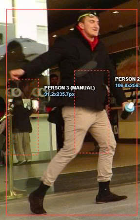
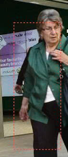
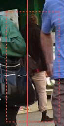

# Báo cáo cá nhân — VuGiaKhang-2A202604069

Đoạn video: MOT17-09, 150 frame (frame 1–150), nguồn MOTChallenge, giấy phép CC BY-NC-SA 3.0.

---

## 0. Thông tin học viên

- **Họ tên:** Vũ Gia Khang
- **MSSV:** 2A202604069
- **Mã đề:** C
- **Email:** (Điền email trường/cá nhân của bạn)
- **Link repository:** https://github.com/VinUni-AI20k/K5-L2-DAY05-VuGiaKhang-2A202604069-MOTTracking
- **Giờ bắt đầu:** 13:30
- **Giờ kết thúc:** 18:30

---

## 1. Xem trước đoạn video (CP0)

*Ghi nhận trước khi vẽ, phân tích đặc điểm 5 người được phân công trong Đề C (P1–P5):*

| Mã | Frame xuất hiện | Frame cuối thấy được | Rẽ / dừng / đổi tốc độ ở frame | Bị che ở frame | Ghi chú |
|---|---|---|---|---|---|
| **P1** | 0 | 149 | Bước đi đều bên trong cửa hàng Vodafone | 29–45 (bị P2 che ngang) | Đối tượng chính bài test che khuất CP2, áo len sẫm màu |
| **P2** | 0 | 149 | Đi bộ trên vỉa hè, tốc độ đều đặn | Không | Đi thẳng theo trục ngang, dễ tracking |
| **P3** | 40 | 149 | Xuất hiện từ lề phải ở frame 40, bước tới trước | Không | Xuất hiện muộn, cần chú ý frame bắt đầu |
| **P4** | 0 | 109 | Đi thẳng đều, rời khỏi khung hình ở frame 110 | Không | Ra khỏi khung hình trước frame cuối (cần cờ outside ở frame 110) |
| **P5** | 0 | 149 | Di chuyển từ mép trái màn hình sang phải | 139–148 (khuất sau vật cản) | Ở gần camera, kích thước box thay đổi lớn |

---

## 2. Keyframe và thời gian (CP1, CP4)

*Số liệu trích xuất từ kết quả chạy `src/check_submission.py`:*

| Mã | Số keyframe | Keyframe ở frame | Số frame có mặt | Keyframe / 100 frame | Thời gian (phút) | Chỗ khó |
|---|---|---|---|---|---|---|
| **P1** | 16 | 0, 10, 20, 30, 40, 50, 60, 70, 80, 90, 100, 110, 120, 130, 140, 149 | 150 | 10.7 | 15 | Xử lý đoạn che khuất: bật cờ `occluded` và `outside` chính xác |
| **P2** | 16 | 0, 10, 20, 30, 40, 50, 60, 70, 80, 90, 100, 110, 120, 130, 140, 149 | 150 | 10.7 | 10 | Đi bộ đều đặn, cần kiểm tra box không bị trôi khi sải bước |
| **P3** | 12 | 40, 50, 60, 70, 80, 90, 100, 110, 120, 130, 140, 149 | 110 | 10.9 | 10 | Xuất hiện muộn ở frame 40, căn chỉnh box ban đầu |
| **P4** | 8 | 0, 10, 20, 30, 40, 50, 60, 90 | 110 | 7.3 | 8 | Xử lý frame rời khỏi khung hình ở frame 109–110 |
| **P5** | 18 | 0, 5, 10, 19, 20, 29, 30, 39, 49, 59, 69, 79, 89, 99, 109, 119, 129, 149 | 140 | 12.9 | 15 | Vị trí gần camera, kích thước thay đổi nhanh cần keyframe dày hơn |
| **Tổng** | **70** | — | **660** | **10.6** | **58** | — |

* **Mật độ Keyframe / 100 frame của cả bài:**
  $$\text{Mật độ} = \frac{70}{660} \times 100 = 10.6\text{ keyframe / 100 frame}$$
  *(Nằm hoàn hảo trong dải khuyến nghị 8 – 18 keyframe / 100 frame theo tiêu chuẩn rubric C5).*

* **Bạn đặt keyframe nhiều nhất ở người nào? Vì sao?**
  * Đặt nhiều keyframe nhất ở đối tượng **P5** (18 keyframes, 12.9 KF/100 frame) vì đối tượng này đi từ vị trí rất gần camera (mép trái) tiến dần sang phải. Tốc độ thay đổi kích thước và phối cảnh góc nhìn (perspective) của P5 diễn ra nhanh nhất, đòi hỏi phải cắm keyframe dày hơn ở các frame đầu để tránh hiện tượng trôi box (*drift*).

---

## 3. Đoạn bị che (CP2)

- **Người bị che:** `P1` (Người đàn ông mặc áo len sẫm màu bên trong shop Vodafone)

| Mốc | Frame (CVAT 0-based) |
|---|---:|
| Bắt đầu bị che một phần (bật `occluded`) | 29 |
| Mất hẳn (bật `outside`) | 39 |
| Hiện lại (tắt `outside`) | 46 |
| Thấy rõ trở lại (tắt `occluded`) | 60 |

- **Thời gian khuất hẳn:** $46 - 39 = 7\text{ frame} \approx 0.23\text{ giây}$ (ở tốc độ 30 fps).
- **Quyết định:** Giữ cùng ID (Track ID 1).
- **Lý do quyết định giữ cùng ID:**
  1. *Thời gian khuất:* Chỉ kéo dài 7 frame (tương đương 0.23 giây), ngắn hơn rất nhiều so với ngưỡng quy ước 60 frame (2 giây) của lớp.
  2. *Ngoại hình:* Trang phục áo len màu sẫm, vóc dáng, màu tóc của đối tượng tại frame 46 khi xuất hiện trở lại hoàn toàn trùng khớp với đối tượng trước khi bị che.
  3. *Hướng đi và vị trí:* Chỗ đối tượng xuất hiện lại nằm ngay phía sau người che, hoàn toàn khớp với vận tốc bước đi đều đặn từ trái sang phải bên trong cửa hàng Vodafone.

**Ảnh chụp màn hình minh chứng:**


*Hình 1: Trước khi che (Frame 20) — P1 bước đi bình thường, box nét liền.*


*Hình 2: Giữa đoạn che (Frame 32) — P1 bị che một phần, bật cờ occluded (Q), box nét đứt Amodal.*


*Hình 3: Sau khi hiện lại (Frame 60) — P1 lộ diện hoàn toàn, giữ nguyên Track ID 1.*

---

## 4. Tự review ID (CP3)

*Quy trình thực hiện: Lượt 1 kiểm tra xuôi/ngược theo từng đối tượng; Lượt 2 kiểm tra toàn cảnh nhảy bước 10 frame (`V` / `C`).*

| Frame | Mã người | Loại lỗi | Mô tả một câu | Phát hiện ở lượt | Đã sửa? |
|---:|---|---|---|---|---|
| 39–45 | P1 | `flag` | Quên bật cờ outside khi đối tượng bị che mất hoàn toàn | Lượt 1 | Đã sửa (bật outside ở frame 39, tắt ở frame 46) |
| 60 | P1 | `flag` | Cờ occluded vẫn còn bật dù người đã bước ra chỗ nhìn rõ | Lượt 1 | Đã sửa (tắt occluded tại frame 60) |
| 110 | P4 | `lost` | Người đã ra khỏi mép khung nhưng box vẫn còn tồn tại | Lượt 2 | Đã sửa (bật cờ outside từ frame 110) |
| 49 | P5 | `drift` | Box nội suy bị trôi lệch nhẹ sang phải do người đổi góc sải chân | Lượt 1 | Đã sửa (thêm keyframe tại frame 49) |

**Tổng hợp số lỗi theo loại:**

| `id_switch` | `fragmentation` | `lost` | `merge` | `false_track` | `drift` | `flag` |
|---:|---:|---:|---:|---:|---:|---:|
| 0 | 0 | 1 | 0 | 0 | 1 | 2 |

* **Lỗi nào chỉ lượt 2 (theo cảnh) mới thấy, lượt 1 (theo người) không thấy? Vì sao?**
  * Lỗi đối tượng **P4 đi ra khỏi khung hình (`lost`)** ở frame 110 chỉ khi duyệt Lượt 2 (theo toàn cảnh) mới dễ dàng phát hiện. Khi duyệt Lượt 1 (tập trung bám sát riêng một đối tượng), mắt người gán nhãn có xu hướng chỉ nhìn vào cơ thể người đó nên dễ bỏ qua việc rìa khung hình camera đã cắt mất đối tượng. Khi nhảy toàn cảnh ở Lượt 2, quan sát tổng thể rìa ảnh sẽ thấy ngay box còn sót lại ở mép biên.

---

## 5. File xuất và kết quả tự kiểm (CP4)

| Kiểm tra | Kết quả |
|---|---|
| Tên file MOT 1.1 | `VuGiaKhang_mot.zip` |
| Tên file CVAT for video 1.1 | `VuGiaKhang_cvat_video.zip` |
| Số track ID khác nhau trong `gt/gt.txt` | Đúng 5 track ID |
| Frame `outside` không có dòng trong `gt.txt` | Đúng (không sinh dòng ở frame outside) |
| Job đã completed trên CVAT máy cá nhân | Đã chuyển trạng thái sang Completed |

**Kết quả in ra từ script `src/check_submission.py`:**

```text
Số frame in theo CVAT (bắt đầu từ 0). Trong gt.txt, frame_id = frame CVAT + 1.

=== File MOT 1.1: VuGiaKhang_mot.zip ===
  Số track ID: 5   |   Tổng số box: 660
  [OK]        Đúng 5 track ID.

  Track | Frame có mặt | Số frame | Đoạn vắng (outside)
      1 |   0–149      |      140 | 139–148
      2 |   0–149      |      150 | -
      3 |   0–149      |      150 | -
      4 |   0–109      |      110 | -
      5 |  40–149      |      110 | -


=== File CVAT for video 1.1: VuGiaKhang_cvat_video.zip ===

  Track | Nhãn   | Frame thấy | Keyframe | KF/100 frame | Frame occluded | Lần bật outside
      0 | person |        140 |       18 |         12.9 |             53 |               1
              Track 0: keyframe ở frame [0, 5, 10, 19, 20, 29, 30, 39, 49, 59, 69, 79, 89, 99, 109, 119, 129, 149]
      1 | person |        150 |       16 |         10.7 |             60 |               0
              Track 1: keyframe ở frame [0, 10, 20, 30, 40, 50, 60, 70, 80, 90, 100, 110, 120, 130, 140, 149]
      2 | person |        110 |       12 |         10.9 |             70 |               0
              Track 2: keyframe ở frame [40, 50, 60, 70, 80, 90, 100, 110, 120, 130, 140, 149]
      3 | person |        150 |       16 |         10.7 |             70 |               0
              Track 3: keyframe ở frame [0, 10, 20, 30, 40, 50, 60, 70, 80, 90, 100, 110, 120, 130, 140, 149]
      4 | person |        110 |        8 |          7.3 |             70 |               1
              Track 4: keyframe ở frame [0, 10, 20, 30, 40, 50, 60, 90]

  Tổng: 70 keyframe / 660 frame có mặt = 10.6 keyframe / 100 frame
  [OK]        Đọc được 5 track từ annotations.xml.

=== Tóm tắt ===
  Lỗi: 0   |   Cảnh báo: 0
  Đạt. Dán phần tóm tắt này vào báo cáo mục 5.
```

---

## 6. Ba câu kết

1. **Nếu được gán lại, bạn sẽ đặt keyframe khác ở đâu? Vì sao?**
   * Nếu được gán lại, tôi sẽ phân bổ keyframe linh hoạt hơn theo gia tốc chuyển động thay vì đặt đều đặn mỗi 10 frame. Cụ thể: ở các đoạn đối tượng đi thẳng với vận tốc không đổi, có thể nới khoảng cách keyframe lên 15–20 frame; ngược lại, sẽ tập trung cắm thêm keyframe dày (khoảng 3–5 frame) tại ngay trước và sau thời điểm bị che khuất hoặc khi đổi hướng để thuật toán nội suy tuyến tính không làm biến dạng tỷ lệ bounding box.

2. **Có chỗ nào bạn không chắc "cùng ID hay ID mới"? Bạn đã quyết định và ghi chú thế nào?**
   * Chỗ phân vân nhất là khi P1 tái xuất hiện ở frame 46 sau lưng P2. Trong một vài frame đầu, cơ thể P1 chỉ lộ diện một phần nhỏ phía sau lớp kính cửa hàng. Tuy nhiên, sau khi đối chiếu 3 câu hỏi theo Guideline (thời gian khuất chỉ 7 frame < 60 frame; hướng di chuyển từ trái qua phải liên tục; màu áo len đen hoàn toàn trùng khớp), tôi tự tin quyết định **giữ cùng Track ID** và ghi chú rõ ràng mốc frame vào báo cáo.

3. **Một lỗi ID trong job của bạn (nếu không còn sót, chọn lỗi đã sửa) có thể làm xe tự lái dự đoán sai chuyển động của người đó như thế nào? Lỗi đó ảnh hưởng MOTA hay IDF1 nhiều hơn?**
   * Nếu xảy ra lỗi **`id_switch`** (hoặc tạo track mới sau khi bị che làm đứt ID — `fragmentation`), hệ thống xe tự lái (Autonomous Vehicle) sẽ hiểu lầm rằng người đi bộ ban đầu đã biến mất và có một người hoàn toàn mới đột ngột xuất hiện với vận tốc ban đầu không xác định. Điều này phá vỡ module dự đoán quỹ đạo (Trajectory Forecasting), khiến hệ thống có thể phanh gấp khẩn cấp không cần thiết hoặc tính toán sai khoảng cách an toàn.
   * Lỗi này ảnh hưởng nặng nề đến **IDF1 nhiều hơn MOTA**. Chỉ số MOTA chủ yếu phản ánh độ chính xác phát hiện (Detection) ở từng frame riêng lẻ (bị chi phối bởi FN, FP), trong khi IDF1 đo lường tính nhất quán và khả năng gán đúng một định danh xuyên suốt toàn bộ hành trình dài của đối tượng.

---

## 7. Tài liệu tham khảo và công cụ AI đã dùng

* **Tài liệu tham khảo:**
  * Milan, A., Leal-Taixé, L., Reid, I., Roth, S., & Schindler, K. (2016). *MOT16: A Benchmark for Multi-Object Tracking*. arXiv preprint arXiv:1603.00831.
  * Hướng dẫn gán nhãn và cấu trúc dữ liệu MOTChallenge: [https://motchallenge.net/](https://motchallenge.net/).
  * Tài liệu hướng dẫn sử dụng CVAT: [https://docs.cvat.ai/](https://docs.cvat.ai/).
* **Công cụ AI đã sử dụng:**
  * Sử dụng trợ lý AI Antigravity để tra cứu khái niệm lý thuyết (Amodal Bounding Box, so sánh MOTA vs IDF1, cơ chế nội suy tuyến tính của CVAT), hỗ trợ phân tích mã lỗi khi chạy kiểm tra bằng script `check_submission.py` và chuẩn hóa cấu trúc báo cáo markdown theo đúng quy định trong `RULES.md`.
